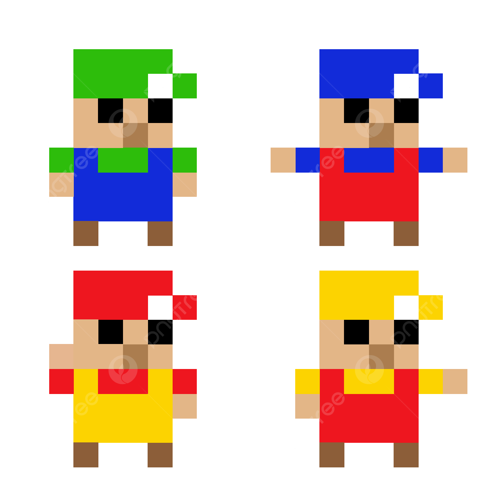

# nexus_pixel_man_test_data
A set of test data for file format conversion, based on 8x8 pixel men.

This provides a `data_source` and `data_converter` for presneting a simple set of tszt data.
The idea here is that the data is very structured, and so can be inspected visually to verify that anything processing the data is working correctly.

The data was inspired by this picture:

This was doenalided from [png tree](https://ms.pngtree.com/freepng/8-bit-vector-pixel-art-character-illustration-8x8-px_7689877.html) (2026-07-07)

To recreate this a "spectrum" was generated for each component of each colour, such that the sum of the intensities within a particular range gives the red green and blue values for a particular pixel.

In the 2D version of the data (`Man2DDataSourse`), the data is presented as an 8x8 grid with spectra: (x,y,mz). Each man take a potion of the spectra.
That is, if you sum all the intensities ofver all the X and Y values with mz between 0 and 60 you will recover man 1, between 61 abd 120 man2, and so on.

## Data 
There is a script that can generate the data (the `.txt` and `colord.json` files) has been included. 
However one particular instance of this data has also been included. 
The `ManData` reads the `.txt` and `colors.json` files and provides the data in both dense (`.dense`) and sparse (`.total_pos`, `.total_int`) representations. The raw sparse data for each man is also provided (`.men`.)

The `Man2DDataSource` uses `ManData` and exposes the data as a `data_source` under various configurations.

